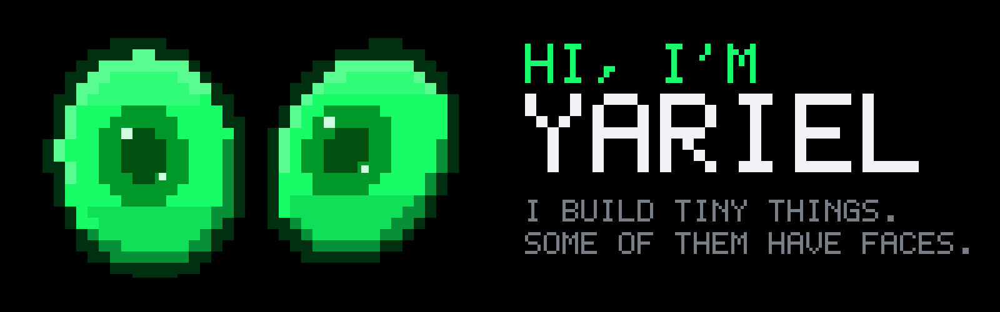

  

&nbsp;

### now

Building **[NoVas](https://github.com/Yarielito06/NoVas)**, a keychain pocket friend with a touch screen and pixel eyes that feel alive. Open source: the firmware, the 3D-printable case and the tools to make your own.

&nbsp;

### things

- **[NoVas](https://github.com/Yarielito06/NoVas)** · a pocket friend with a face · MicroPython, ESP32-S3, 3D printing
- **[Lockin](https://github.com/Yarielito06/lockin)** · an iOS focus app that blocks distractions and cheers on friends · Swift
- **[Casefile Detective](https://github.com/Yarielito06/casefile-detective)** · Python

Most of my other work lives in private repos. Ask if you'd like a demo.

&nbsp;

### made with

`python` `micropython` `swift` `typescript` `dart`

&nbsp;

the pixel eyes above are a real picture of NoVas's screen.
